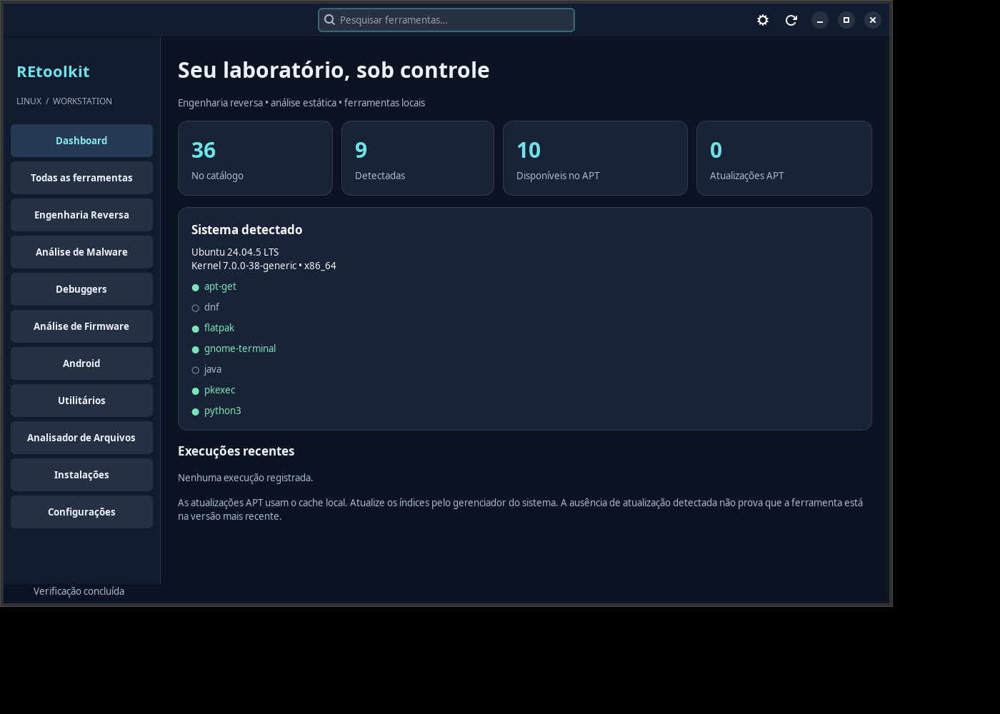

<div align="center">


# REtoolkit Linux

**Suas ferramentas de engenharia reversa, em um só lugar.**

Desktop nativo para Linux com catálogo de ferramentas, detecção do ambiente e análise estática local.
Construído em **Rust, GTK4 e libadwaita**.


[**Downloads**](https://github.com/feipecart1/REtoolkit-Linux/releases) · [Instalação](#instalação) · [Funcionalidades](#funcionalidades-do-aplicativo) · [Desenvolvimento](#desenvolvimento)



</div>

## Escolha sua edição

As duas edições oferecem a mesma interface. Escolha uma instalação enxuta ou comece com as principais ferramentas incluídas. **Rust e Cargo não são necessários para usar o aplicativo.**

<div align="center">

&nbsp;&nbsp;&nbsp;&nbsp;

</div>

| Edição | Conteúdo | Para quem |
|---|---|---|
| **Light** | Aplicativo, catálogo de 36 ferramentas, detecção e analisador. Ferramentas instaláveis sob demanda. | Quem já tem suas ferramentas ou prefere uma instalação menor. |
| **Full** | Aplicativo + **Ghidra 12.2, Cutter 2.5.0, radare2 6.2.4 e Temurin JDK 25.0.5** em prefixo privado. Os pacotes DEB/RPM também instalam ferramentas básicas pelo gerenciador nativo. | Quem quer começar com os principais programas já preparados. |

A Full é uma seleção definida de ferramentas, **não inclui automaticamente as 36 entradas do catálogo**. Binary Ninja e outras ferramentas comerciais continuam dependendo da licença do usuário. As ferramentas incluídas são distribuições oficiais verificadas por SHA-256 e preservam suas próprias licenças.

## Instalação

Baixe o instalador da edição desejada na página de [Releases](https://github.com/feipecart1/REtoolkit-Linux/releases). Para Ubuntu, use o **DEB**; para execução portátil, escolha o **AppImage**. O **RPM** tem suporte experimental.

Os comandos abaixo devem ser executados na pasta onde você salvou o download. Para builds locais, os arquivos ficam em `dist/light/` e `dist/full/`.

No Ubuntu 24.04 x86_64, escolha **um** dos comandos:

```bash
# Light
sudo apt install ./retoolkit-linux-light_0.2.1_amd64.deb

# OU Full
sudo apt install ./retoolkit-linux-full_0.2.1_amd64.deb
```

Depois abra **REtoolkit Linux Light** ou **REtoolkit Linux Full** no menu, ou execute `retoolkit-linux`. O programa abre como usuário comum. Somente a instalação de sistema exige autorização administrativa.

O APT resolve as dependências da Full na própria transação. Não há `postinst` baixando programas, outro APT rodando dentro do APT ou ferramentas sendo executadas como root durante a instalação. Ghidra, Cutter, radare2 e Java já estão no conteúdo do pacote; as ferramentas básicas são baixadas dos repositórios configurados quando necessárias. A instalação por DEB pode precisar de rede para essas dependências.

Os dois pacotes declaram conflito entre si e substituem a antiga edição `retoolkit-linux`. O APT deve apresentar a troca antes da confirmação. Feche o aplicativo antes de mudar de edição. Configurações XDG são compartilhadas e não são removidas. Ferramentas básicas instaladas como dependências são gerenciadas pelo APT, não apagadas indiscriminadamente pela remoção da aplicação.

Em Fedora compatível, os RPMs experimentais são:

```bash
sudo dnf install ./retoolkit-linux-light-0.2.1.x86_64.rpm
# OU
sudo dnf install ./retoolkit-linux-full-0.2.1.x86_64.rpm
```

Ao trocar uma edição RPM já instalada, use a operação de troca do DNF e revise a transação. O suporte Fedora ainda exige teste de sistema limpo: gerar e validar o arquivo RPM no Ubuntu não é certificação Fedora.

## AppImage

Também há dois AppImages:

```bash
chmod +x ./REtoolkit-Linux-Light-0.2.1-x86_64.AppImage
./REtoolkit-Linux-Light-0.2.1-x86_64.AppImage

# OU
chmod +x ./REtoolkit-Linux-Full-0.2.1-x86_64.AppImage
./REtoolkit-Linux-Full-0.2.1-x86_64.AppImage
```

Sem FUSE, prefixe o comando escolhido com `APPIMAGE_EXTRACT_AND_RUN=1`. A extração temporária da Full exige espaço livre adicional, pois o conteúdo descompactado inclui as ferramentas e o JDK.

A **Full AppImage contém os três programas principais e Java**, além do runtime GTK do aplicativo. Ela não instala os pacotes adicionais APT/DNF no host. Estes são uma conveniência dos instaladores nativos; permanecem sob demanda no AppImage. Ambos os AppImages continuam usando a glibc e os drivers do sistema, com baseline Ubuntu 24.04/glibc 2.39; não são universais.

## Conteúdo exato da Full

| Componente | Origem e gerenciamento |
|---|---|
| Ghidra 12.2 | ZIP oficial NSA, com Java 25 incluído e lançador relativo ao prefixo privado. |
| Cutter 2.5.0 | AppImage oficial extraído no momento da construção; execução não depende de FUSE. Inclui Rizin conforme o upstream. |
| radare2 6.2.4 | Pacote oficial do projeto extraído no prefixo privado; bibliotecas e dados acompanham o binário. |
| Temurin JDK 25.0.5 | Distribuição oficial Adoptium, privada à Full; não modifica o Java padrão do sistema. |
| Ferramentas básicas DEB | GDB, YARA, strace, ltrace, file, binutils (strings/readelf/objdump), xxd, patchelf e hashdeep. |
| Ferramentas básicas RPM | GDB, YARA, strace, ltrace, file, binutils, vim-common (xxd) e patchelf, conforme perfil Fedora. |

As versões incluídas no prefixo são atualizadas com uma nova edição Full. Não são substituídas silenciosamente por atualizações APT/DNF de ferramentas externas. A aplicação prioriza os lançadores privados da Full e mostra a versão do pacote quando não há uma consulta de versão confiável sem abrir a GUI.

Ghidra e Cutter preservam seus próprios diálogos de primeiro uso. O aplicativo não aceita acordos em nome do usuário. A distribuição Cutter escolhida usa Qt/XCB e pode precisar de XWayland em uma sessão Wayland; a interface principal REtoolkit usa GTK nativo.

## Funcionalidades do aplicativo

- Dashboard com distribuição, kernel, arquitetura, dependências e ferramentas detectadas. Disponibilidade e atualizações APT vêm do cache local.
- Catálogo JSON versionado, busca, categorias, fontes oficiais, licenças e detalhes das ações disponíveis.
- Instalações APT com simulação de transação, confirmação, polkit, logs e nova detecção; backends iniciais DNF e Flatpak por usuário.
- Instalação privada de hashdeep, separada da Full, com HTTPS e checksum.
- Abertura de ferramentas GUI e CLI com argumentos estruturados, sem shell. O terminal aguarda Enter para manter o resultado visível. Histórico diferencia processo iniciado de comando concluído.
- Inspeção local ELF/PE, cabeçalho DEX, metadados ZIP/APK, SHA-256, seções, strings e identificação inicial de firmware. Seleção por diálogo e arrastar/soltar.
- Configurações XDG, modo escuro e opção de seguir o sistema. Ctrl+F pesquisa; Ctrl+Q solicita fechamento.

O catálogo não garante instalação automática de todas as entradas. Ferramentas sem método configurado têm acesso ao site oficial; plugins GDB ainda podem exigir configuração manual. A versão Light continua oferecendo o fluxo de instalação sob demanda, incluindo radare2 quando há candidato APT.

<details>
<summary><strong>Atalho e instalação por usuário</strong></summary>

## Atalho e instalação por usuário

Light: **Configurações → Instalar aplicativo para meu usuário** cria uma cópia do ELF em `$XDG_DATA_HOME/retoolkit-linux/app`, ícone e lançador no menu. Marque o atalho opcional para usar a pasta retornada por `xdg-user-dir DESKTOP`. Arquivos existentes não são sobrescritos; requer GTK/libadwaita no sistema.

Full: utilize o DEB/RPM ou mantenha o AppImage completo. O copiador simples por usuário é bloqueado na Full para não separar o executável dos programas incluídos.

Após instalar um pacote nativo, o atalho pode ser copiado manualmente:

```bash
retoolkit_desktop="$(xdg-user-dir DESKTOP)"
cp -n /usr/share/applications/io.github.retoolkitlinux.REtoolkit.desktop "$retoolkit_desktop/REtoolkit Linux.desktop"
chmod +x "$retoolkit_desktop/REtoolkit Linux.desktop"
```

Confirme o diretório retornado. O GNOME pode exigir extensão de ícones e a ação **Permitir iniciar**. O lançador tem `Terminal=false`; não há tentativa de contornar as regras do desktop.

</details>

## Segurança, offline e limites

Amostras nunca são executadas ou enviadas a serviços externos. O parser da interface roda em subprocesso com limite de 384 MiB de espaço de endereçamento, 10 segundos de CPU e 20 segundos totais. Somente arquivos regulares de até 64 MiB: até 512 seções/entradas e 2.000 strings de até 1.024 bytes. ZIP/APK é listado sem extração; firmware não é emulado. O REtoolkit não é uma sandbox: use uma VM isolada para amostras hostis.

Não há `curl | bash`, construção de comandos de shell com entradas externas ou armazenamento de senhas. O polkit solicita os privilégios para transações nativas. Operações são seriais; transações APT/DNF não têm interrupção forçada pela interface. Downloads privados podem ser cancelados. O AppImage restaura as bibliotecas do host ao chamar ferramentas externas, evitando misturar GTK do pacote com programas do sistema.

Catálogo, busca, detecção e análise estática funcionam offline. Instalações e atualizações de ferramentas podem precisar de rede ou cache. O canal de atualização da própria aplicação ainda não foi configurado; nenhuma atualização é silenciosa. Logs ficam em `$XDG_DATA_HOME/retoolkit-linux/operations.log` e `history.log`; podem conter caminhos e ainda não possuem rotação automática.

## Compatibilidade e evidências

Baseline: Linux x86_64, glibc ≥ 2.39, GTK ≥ 4.10, libadwaita ≥ 1.4. DEB calcula dependências ELF e impõe esse mínimo de API; Full declara runtimes adicionais das ferramentas. Ambiente de validação: Ubuntu 24.04.5, GTK 4.14.5, libadwaita 1.5.0.

Ubuntu 26.04, Debian, Fedora, Mint e Pop!_OS ainda precisam de testes próprios em sistemas limpos. Testes em prefixos privados com dependências do host não comprovam resolução de dependências nessas distribuições. O backend DNF/Flatpak ainda requer testes de transação real.

## Desenvolvimento

Consulte o [guia de desenvolvimento](docs/DEVELOPMENT.md) para compilar, testar e gerar as edições Light e Full.

## Licenças e redistribuição

Código original sob MIT, inspirado no conceito do [REtoolkit da Mente Binária](https://github.com/mentebinaria/retoolkit), sem reutilizar código ou identidade visual. Metadata AppStream sob CC0-1.0. Bibliotecas e programas incluídos mantêm suas licenças originais; “Full” não os relicencia como MIT.

Os pacotes preservam `LICENSE`, `NOTICE`, diretórios `legal` e os recursos originais dos fornecedores. Avisos das dependências Cargo acompanham os instaladores; avisos de bibliotecas Ubuntu acompanham os AppImages. `dist/full/sources/` contém arquivos-fonte oficiais de Cutter (incluindo Rizin), radare2 e JDK, com manifesto/checksums. Ao distribuir a Full, disponibilize também os arquivos-fonte e avisos correspondentes; não publique apenas o binário como se fosse integralmente MIT. Dependências embarcadas do AppImage de terceiros também mantêm suas obrigações próprias; uma release pública ainda exige revisão completa desses componentes.
